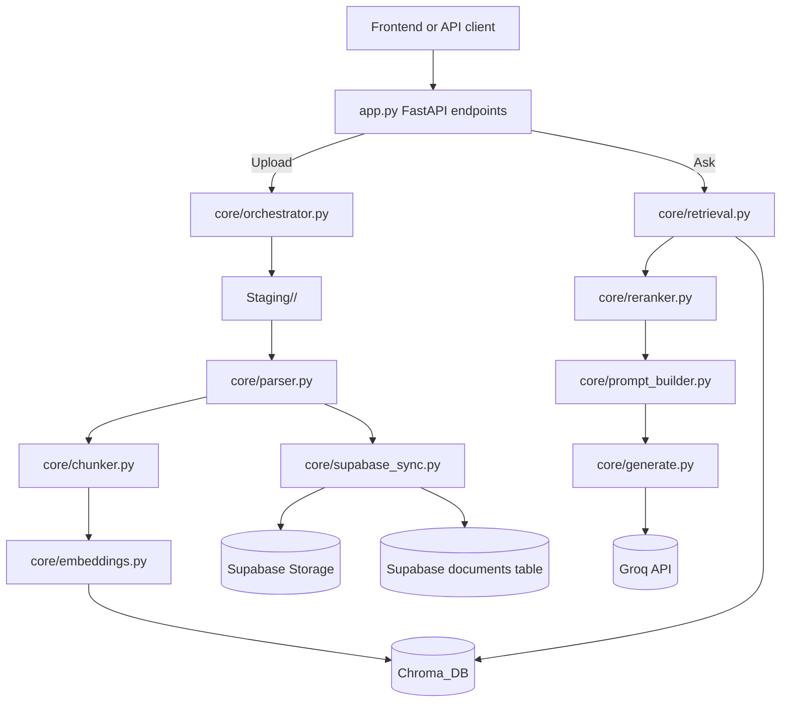

# Backend Codebase Guide

This document explains the backend directory, its source files, runtime data, tests, configuration, and the relationships between components.

## 1. Project Overview

This backend is a FastAPI RAG (Retrieval-Augmented Generation) service for reading PDF documents and answering questions from them.

The main processing flow is:

1. A client uploads a PDF through `POST /upload`.
2. `app.py` delegates the request to `core/orchestrator.py`.
3. The orchestrator streams the upload into a unique directory under `Staging/`.
4. `core/parser.py` extracts markdown and per-page JSON text with PyMuPDF.
5. `core/chunker.py` divides pages into overlapping text chunks.
6. `core/embeddings.py` embeds the chunks with a Nomic Sentence Transformer and stores them in local ChromaDB.
7. `core/supabase_sync.py` uploads the original PDF and extracted assets to Supabase Storage.
8. `core/supabase_service.py` creates or updates the document metadata row in Supabase PostgreSQL.
9. `/ask` or `/ask/stream` uses `core/retrieval.py`, `core/reranker.py`, `core/prompt_builder.py`, and `core/generate.py`.
10. The Groq API generates a grounded answer, and the API returns the answer plus source pages.



## 2. Top-Level Files

| File | Purpose | Connections |
|---|---|---|
| `app.py` | Main FastAPI application and public HTTP API. Defines routes, CORS, logging, startup recovery, request models, and SSE responses. | Imports `core.orchestrator`, file listing/document selection, staging, and Supabase synchronization/download modules. |
| `pyproject.toml` | Python project metadata and dependency declarations. Also declares this package's `uv` build configuration and the Git-based `applog` dependency. | Used by `uv` and Python packaging tools. Installed dependencies are reflected in `uv.lock`. |
| `uv.lock` | Fully resolved, platform-aware dependency lock file generated for `uv`. | Used by `uv sync` and `uv run` to reproduce dependencies. |
| `.python-version` | Requests Python 3.14 for tools that understand Python version files. | Consistent with `requires-python >=3.14` in `pyproject.toml`. |
| `README.md` | Short setup, run, feature, and endpoint overview for the backend. | Summarizes the application implemented by `app.py` and `core/`. |
| `.env.example` | Template for environment variables. Contains no real credentials. | Read by modules that call `load_dotenv()`. |
| `.gitignore` | Prevents generated and sensitive runtime artifacts from being committed. | Excludes `.venv/`, `.env*`, `Media/`, `Embedding_Model/`, `Chroma_DB/`, `Staging/*/`, logs, caches, builds, and bytecode. |
| `__init__.py` | Marks the backend directory as a Python package. | Allows imports such as `backend.app` and `backend.core.*` from the repository root. |
| `CODEBASE_GUIDE.md` | This architecture and file-by-file reference. | Documents the complete backend. |

## 3. `app.py`

`app.py` is the application entry point.

### Startup and middleware

- Creates the FastAPI app with a custom title and a lifespan context manager.
- Configures `applog` file and request logging under `logs/`.
- Enables CORS from `CORS_ORIGINS`, with `*` as the default.
- Runs `_resume_incomplete_jobs()` during startup. This scans `Staging/` for jobs that have not committed their Supabase database record and resumes them in a worker thread.

### API endpoints

| Endpoint | Method | Behavior |
|---|---|---|
| `/` | GET | Health check string. |
| `/upload` | POST | Validates and stores the PDF, then runs the ingestion pipeline. |
| `/ask` | POST | Performs retrieval, reranking, prompt construction, and one synchronous Groq response. |
| `/ask/stream` | POST | Performs retrieval and streams source and token events with Server-Sent Events. |
| `/list_files` | GET | Lists document filenames recorded in Supabase. |
| `/files/{filename}` | GET | Downloads a PDF from Supabase Storage and streams it with `application/pdf`. |
| `/markdown/{filename}` | GET | Downloads a parsed JSON extract or Markdown fallback from Supabase Storage. |

The `AskRequest` Pydantic model accepts `query`, optional `doc_name`, and optional conversation `history`.

## 4. `core/` Source Modules

### `core/orchestrator.py`

The central application workflow coordinator. It also exposes the main separation between upload, ingestion, and query operations.

- `validate()` accepts only names ending in `.pdf`.
- `save()` streams uploads in 1 MB chunks, rejects files above 50 MB, writes bytes to `Staging/<doc_id>/`, and returns a `StagingContext`.
- `process()` calls `parse_pdf()`, then `sync_to_supabase()`.
- `query()` performs dense retrieval, reranking, prompt construction, and Groq generation.
- `stream_query()` implements the same retrieval path and yields SSE events for sources, tokens, and completion.
- Maps retrieval and Groq failures to HTTP 404, 401, 429, 502, or 500 responses.

It connects `staging_manager`, `parser`, `retrieval`, `reranker`, `prompt_builder`, `generate`, exceptions, and Supabase sync.

### `core/parser.py`

Extracts usable text from the staged PDF.

- Opens the PDF with PyMuPDF (`fitz`) and calls `pymupdf4llm.to_markdown(..., page_chunks=True)`.
- Explicitly closes the PyMuPDF document in a `finally` block to release C-heap memory.
- Writes a full Markdown file, a page-by-page JSON file, and chunk JSON to the staging directory.
- Calls `chunk_pages()` and `embed()` for the in-memory extraction.
- Updates `state.json` with page count and parsing status.

Its output files are consumed by `supabase_sync.py`, while its chunk objects are consumed by `embeddings.py`.

### `core/chunker.py`

Splits the text on each extracted page into chunks.

- Uses LangChain `RecursiveCharacterTextSplitter`.
- Default chunk size is 2000 characters and overlap is 400 characters.
- Adds `page_number` and `doc_name` metadata to every LangChain `Document`.
- The document name is the PDF filename stem, and is later used as a ChromaDB filter.

### `core/embeddings.py`

Owns embedding-model loading and the ChromaDB collection.

- Loads `.env`.
- Caches model instances on first use.
- Stores the Nomic Sentence Transformer cache under `Embedding_Model/`.
- Stores persistent ChromaDB data under `Chroma_DB/`.
- Adds `search_document:` prefixes for document embeddings and `search_query:` prefixes for questions.
- Uses the collection named `my_embedded_pdfs`.
- `generate_ids()` produces IDs such as `document_page1_chunk0`.
- `embed()` accepts chunk dictionaries or a JSON file path.
- Re-uploading a document upserts current IDs and deletes obsolete IDs for that document.

This module is used directly by `parser.py` during ingestion and is indirectly used by `retrieval.py` for query embedding.

### `core/retrieval.py`

Performs semantic retrieval from ChromaDB.

- Opens the persistent `my_embedded_pdfs` collection.
- Rejects an empty collection with `EmptyCollectionError`.
- Rejects unknown document names with `DocumentNotFoundError`.
- Embeds the query using `EmbeddingModel.embed_query()`.
- Optionally filters with ChromaDB metadata `{"doc_name": doc_name}`.
- Returns the top 20 candidates by default, clamped to the collection size.
- Preserves text, metadata, ID, and vector distance.

The result is passed to `reranker.py`.

### `core/reranker.py`

Reranks retrieval candidates with a cross-encoder.

- Lazily loads `cross-encoder/ms-marco-MiniLM-L-6-v2`.
- Creates query/chunk pairs and asks the model for relevance scores.
- Adds `rerank_score` to each chunk and sorts by descending score.
- Returns the top 3 chunks in normal orchestration or a caller-selected limit.

This module improves candidate ranking after the faster ChromaDB retrieval stage.

### `core/prompt_builder.py`

Formats the top reranked chunks into a prompt.

- Includes each chunk's page number and text.
- Instructs the LLM to answer only from the supplied context.
- Instructs the model to state that the document does not specify an answer if context is insufficient.

The generated prompt is passed to `generate_response()` or `stream_response()`.

### `core/generate.py`

Contains the Groq LLM integration.

- Lazy-loads and caches the Groq client.
- Reads `LLM`, defaulting to `openai/gpt-oss-20b`.
- Trims conversation history to approximately 4000 tokens using `tiktoken`.
- `generate_response()` requests one complete answer.
- `stream_response()` requests Groq streaming mode and yields response tokens.

It depends on environment configuration and is consumed by `orchestrator.py`.

### `core/staging_manager.py`

Manages resumable local staging workspaces.

- Creates `Staging/<uuid>/` for each upload.
- Stores the PDF, Markdown, page JSON, chunk JSON, and `state.json`.
- `StagingContext` carries all paths and the document ID.
- `update_state()` merges flat updates and nested `synced_assets` updates.
- `cleanup_staging_area()` removes a completed workspace.
- `list_incomplete_jobs()` finds workspaces whose database commit did not finish.

It is used by `orchestrator.py`, `parser.py`, `supabase_sync.py`, and startup recovery in `app.py`.

### `core/supabase_sync.py`

Synchronizes staged assets to Supabase with checkpoints and retries.

- Reads checkpoint flags from `state.json`.
- Uploads assets in this order: PDF, Markdown, page extracts, chunks.
- Uses a Tenacity retry policy of up to five attempts with exponential backoff.
- Commits the PostgreSQL document record only after storage uploads.
- Updates `db_committed` and deletes the staging directory only after full success.

An interruption leaves the staging directory and already-saved checkpoints intact for retry.

### `core/supabase_service.py`

Low-level Supabase configuration and data-access wrapper.

- Validates URL and service-role credentials.
- Lazily creates a singleton Supabase client.
- Creates or verifies the storage bucket.
- Uploads, downloads, signs, and deletes storage objects.
- Upserts and lists rows in the `documents` table.
- Resolves document records and associated storage paths.

This module is used by synchronization, PDF/document selection, Markdown retrieval, and file listing.

### `core/doc_selector.py`

Validates and serves a selected PDF.

- Rejects path traversal characters.
- Normalizes names with or without `.pdf`.
- Downloads `pdfs/<filename>` from Supabase Storage.
- Returns a FastAPI `Response` with PDF MIME type or a 404.

It is connected to `GET /files/{filename}` in `app.py` and `supabase_service.download_bytes()`.

### `core/get_uploaded_files.py`

Small adapter around Supabase document listing.

- `get_file_list()` calls `list_document_filenames()`.
- `app.py` exposes the result through `GET /list_files`.

### `core/exceptions.py`

Defines domain-specific exceptions:

- `EmptyCollectionError`: no documents are embedded.
- `DocumentNotFoundError`: a requested document name does not exist in ChromaDB.
- `ConfigurationError`: required Supabase configuration is missing or invalid.

These exceptions separate domain failures from generic HTTP or network exceptions.

### `core/__init__.py`

Package marker for the `core` package. It contains no application logic.

## 5. `scripts/` and SQL

### `scripts/supabase_schema.sql`

SQL for provisioning Supabase.

- Creates the `public.documents` table and filename index.
- Defines document metadata fields and storage object paths.
- Creates the public `pdf-reader` storage bucket if missing.
- Defines public read, insert, update, and delete storage policies.

It should be run in the Supabase SQL Editor. The application still requires a valid service-role key for server-side operations.

## 6. `tests/`

The tests use `unittest`, `TestClient`, mocks, temporary directories, and patched external services.

| File | Coverage |
|---|---|
| `test_api.py` | FastAPI routes, upload limits and validation, PDF/Markdown downloads, ask responses, Groq model configuration, and HTTP propagation. |
| `test_doc_selector.py` | Filename normalization, traversal prevention, missing PDFs, and document-list adapters. |
| `test_embeddings.py` | Chunk IDs, in-memory/file-path embedding, empty input, re-upload upserts, and stale chunk deletion. |
| `test_staging.py` | Staging folder creation, state defaults and updates, cleanup, context restoration, orphan jobs, and incomplete-job discovery. |
| `test_supabase.py` | Supabase configuration validation, storage upload/download, metadata records, and filename listing with mocked clients. |
| `test_supabase_sync.py` | Sequential sync, checkpoint skipping, DB/asset failure behavior, staging preservation, and Tenacity retry behavior. |
| `test_lazy_loading.py` | Lazy loading and caching of reranker and embedding models plus backward-compatible `embed` attributes. |
| `test_lazy_loading.py` | Also verifies that expensive models are not loaded for empty retrieval input. |
| `tests/__init__.py` | Marks `tests` as a Python package. It contains no test logic. |

Running the suite:

```bash
uv run python -m unittest discover tests
```

## 7. Runtime and Data Directories

| Directory | Purpose | Managed/Generated |
|---|---|---|
| `Staging/` | Scratch workspaces for in-progress uploads. Each job has a UUID directory and `state.json`. | Generated; retains interrupted jobs and cleans them after successful sync. |
| `Media/Uploads/` | Legacy or existing uploaded PDF files. | Runtime/sample data; the current upload pipeline stages files in `Staging/` rather than this folder. |
| `Media/Extracts/` | Legacy or existing Markdown, page JSON, and chunks derived from PDFs. | Runtime/sample data; current staged extracts are in `Staging/` before cloud sync. |
| `Chroma_DB/` | Persistent local vector database and collection metadata. | Generated by `chromadb.PersistentClient`; ignored by Git. |
| `Embedding_Model/` | Downloaded/cached Sentence Transformer model files and Hugging Face cache. | Generated by model download/cache behavior; ignored by Git. |
| `logs/` | Runtime application and error logs created by `applog`. | Generated; ignored by Git. |
| `.venv/` | Local Python virtual environment and installed packages. | Generated by `uv`; ignored by Git. |
| `src/bud/` | Minimal source-layout package area. `src/bud/__init__.py` is currently empty. | Potential package scaffold; not the active import path used by `app.py`. |
| `__pycache__/` and `core/__pycache__/` | Python bytecode caches. | Generated by Python; ignored by Git. |

Do not edit or commit generated directories unless an intentional data migration or model update requires it.

## 8. `docs/` Documentation

| File | Purpose |
|---|---|
| `docs/README.md` | Index and architecture summary for the design documents. |
| `docs/walkthrough.md` | Completed implementation walkthrough for staging and resilient Supabase sync. |
| `docs/implementation_todo.md` | Historical 10-step implementation checklist. |
| `docs/staged_scratch_sync_pipeline.md` | Architecture and proposed implementation for staging and resumable synchronization. |
| `docs/memory_analysis_and_optimization_plan.md` | Memory analysis and strategies for large PDFs. |
| `docs/supabase_integration_plan.md` | Initial Supabase Storage/PostgreSQL integration design. |
| `docs/supabase_as_primary_pipeline.md` | Plan for using Supabase as the primary storage and document catalog. |
| `docs/resumable_packet_upload_plan.md` | Alternatives and design considerations for resumable packet uploads. |
| `docs/pgvector_integration_plan.md` | Analysis of Supabase pgvector; ChromaDB remains the current vector store. |

## 9. Configuration and Environment

Copy `.env.example` to `.env` and configure:

| Variable | Purpose |
|---|---|
| `LLM` | Groq chat model name. Defaults in code to `openai/gpt-oss-20b`. |
| `EMBEDDING_MODEL` | Hugging Face/Sentence Transformer model name. Used by `EmbeddingModel`. |
| `GROQ_API_KEY` | Authentication key for Groq. |
| `SUPABASE_URL` | Supabase project URL. |
| `SUPABASE_SERVICE_ROLE_KEY` | Server-side service-role key. |
| `SUPABASE_STORAGE_BUCKET` | Storage bucket name. Defaults to `pdf-reader`. |
| `CORS_ORIGINS` | Comma-separated allowed origins. Defaults to `*`. |

Supabase is currently required by the primary pipeline. ChromaDB remains the vector search store; `pgvector_integration_plan.md` is a future migration analysis, not current implementation.

## 10. Upload Pipeline Detail

```text
POST /upload
  -> app.upload()
  -> orchestrator.save(file)
  -> Staging/<uuid>/
       PDF, state.json
  -> orchestrator.process(ctx)
  -> parser.parse_pdf(ctx)
       -> chunker.chunk_pages()
       -> embeddings.embed()
       -> Markdown/pages/chunks files
  -> supabase_sync.sync_to_supabase(ctx)
       -> upload PDF
       -> upload Markdown
       -> upload page extracts
       -> upload chunks
       -> upsert documents metadata
       -> delete staging workspace
```

If parsing fails, staging state becomes `parse_failed`. If cloud synchronization fails, state becomes `sync_failed` and the staging workspace remains for startup recovery or a later retry.

## 11. Query Pipeline Detail

```text
POST /ask or /ask/stream
  -> app.ask route
  -> orchestrator.query() or orchestrator.stream_query()
  -> retrieval.search(query, optional doc_name)
       -> embed query
       -> ChromaDB query
  -> reranker.rerank()
  -> prompt_builder.build_prompt()
  -> generate.generate_response() or generate.stream_response()
  -> Groq API
  -> answer and source page numbers
```

If no collection exists, no matching document is found, or no reranked chunk remains, the application returns an error instead of generating an unsupported answer.
