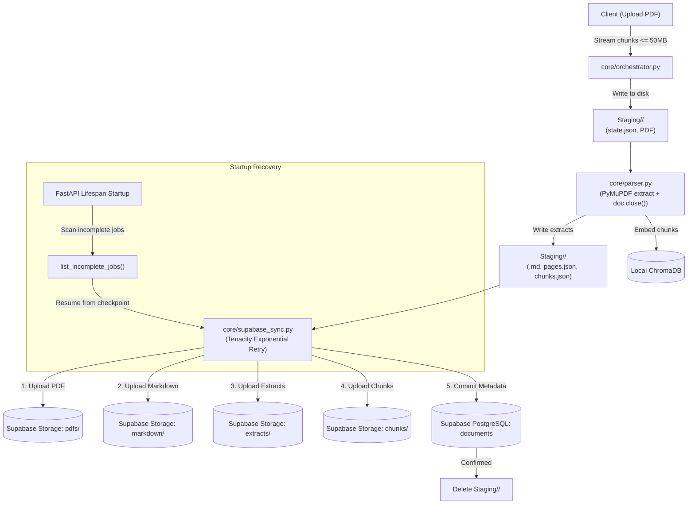

# Project Documentation & Architecture Artifacts

This folder contains all technical design documents, architectural decisions, memory benchmarks, and implementation logs developed for Bud's PDF Reader backend.

---

## 📑 Table of Contents

| Document | Description | Status |
| :--- | :--- | :--- |
| [**`walkthrough.md`**](./walkthrough.md) | Summary of changes, components, and verification results (62/62 tests passing). | ✅ Completed |
| [**`implementation_todo.md`**](./implementation_todo.md) | 10-step sequential checklist tracking execution from staging buffer to test verification. | ✅ 10/10 Complete |
| [**`staged_scratch_sync_pipeline.md`**](./staged_scratch_sync_pipeline.md) | Complete architectural design for the staged scratch buffer and resilient Supabase sync. | Approved & Implemented |
| [**`memory_analysis_and_optimization_plan.md`**](./memory_analysis_and_optimization_plan.md) | Deep memory analysis (PyMuPDF C-heap, PyTorch embeddings) for large (30MB / 400-page) PDFs. | Reference / Benchmark |
| [**`supabase_as_primary_pipeline.md`**](./supabase_as_primary_pipeline.md) | Strategy for decommissioning local `Media/` storage and using Supabase as primary catalog. | Approved & Implemented |
| [**`resumable_packet_upload_plan.md`**](./resumable_packet_upload_plan.md) | Exploration of streaming packets vs. staged scratch buffer sync under flaky networks. | Analysis / Discussion |
| [**`pgvector_integration_plan.md`**](./pgvector_integration_plan.md) | Comparison between Supabase pgvector and ChromaDB vector search. | ChromaDB Retained |
| [**`supabase_integration_plan.md`**](./supabase_integration_plan.md) | Initial integration roadmap for Supabase Storage and PostgreSQL document catalog. | Initial Spec |

---

## 🛠 Architecture Summary

