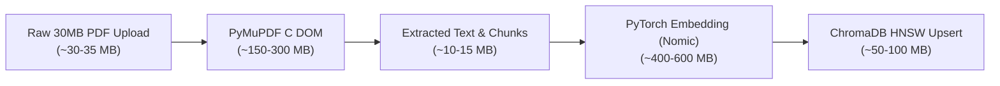

# Memory Analysis & Optimization Plan for Large PDFs (30MB / 400 Pages)

## 1. Goal Description
Analyze the exact memory consumption profile when ingesting a **30 MB PDF with images and ~400 pages** using in-memory extraction, identify potential Out-Of-Memory (OOM) bottlenecks, and plan architectural optimizations to ensure stable operation under constrained or production server environments.

---

## 2. Memory Consumption Breakdown: 30MB / 400 Pages

### 2.1 The Data Flow & RAM Profile



### 2.2 Component-by-Component Analysis

| Component | What it Holds in RAM | Typical RAM | Worst-Case RAM | Risk Level |
| :--- | :--- | :--- | :--- | :--- |
| **Base App Runtime** | FastAPI, PyTorch, Transformers, ChromaDB, AppLog imported into memory | **~350 MB** | ~400 MB | Baseline (static) |
| **Upload Buffering** | `temp_path.read_bytes()` + HTTP upload buffer for Supabase Storage | **~35 MB** | ~60 MB | Low |
| **PDF Parsing (`pymupdf4llm`)** | MuPDF internal C structures parsing 400 pages, fonts, vector paths, embedded image headers | **~180 MB** | ~350 MB | Medium |
| **Extracted Text & Metadata** | 400 pages markdown string (~2MB) + JSON pages list (~3MB) + chunk list (~5MB) | **~10 MB** | ~20 MB | **Negligible** |
| **Embedding Generation (`SentenceTransformer`)** | PyTorch tokenization tensors + model weights forward pass activations (batch=32) | **~450 MB** | ~800 MB | **CRITICAL (High)** |
| **Python Embedding Object Overhead** | ~1,200 chunks × 768 dims = 921,600 Python `float` objects (`.tolist()`) | **~25 MB** | ~35 MB | Low |
| **ChromaDB Vector Upsert** | SQLite write transaction + Rust HNSW index graph updating | **~50 MB** | ~100 MB | Medium |
| **TOTAL PEAK PROCESS RAM** | **Total system RSS during ingestion of one 30MB PDF** | **~1.1 GB** | **~1.7 GB** | **Needs Safeguards** |

> [!NOTE]
> **The Myth about Text Extraction**:
> Extracted text itself is tiny. 400 pages of text is only about 100,000 words (~1.5 MB of raw ASCII/UTF-8). In-memory strings for 400 pages take less than **15 MB**.
>
> **The Real Memory Hog**:
> 80% of peak memory is consumed by **PyTorch during embedding generation** (~400–600 MB) and **MuPDF's internal C context** parsing the 400-page document tree (~200–350 MB).

---

## 3. Potential Failure Scenarios (Out-Of-Memory / OOM)

1. **Free / Cheap Cloud Container Limits**:
   - Environments like Render (512MB), Railway (512MB–1GB), or Fly.io (256MB–1GB) will **immediately OOM-kill** the server process when processing a 400-page PDF if peak memory crosses 1 GB.
2. **Concurrent Ingestions**:
   - If two users upload a 30MB PDF simultaneously without a concurrency queue:
     - $1.1\text{ GB} \times 2 \approx 2.2\text{ GB}$ peak RAM.
3. **PyTorch Tensor Caching**:
   - PyTorch allocates CUDA / CPU tensor arenas that are not immediately returned to the OS unless explicitly collected.

---

## 4. Proposed Architectural Optimizations for Large Documents

### Strategy 1: Concurrency Limiting (`asyncio.Semaphore`)
Ensure only **1 heavy ingestion** runs at a time on the CPU/GPU, while lightweight endpoints (`/ask`, `/list_files`, `/files`) continue serving freely.
```python
# In orchestrator.py
INGESTION_SEMAPHORE = asyncio.Semaphore(1)

@app.post("/upload")
async def upload(file: UploadFile = File(...)):
    async with INGESTION_SEMAPHORE:
        temp_path, safe_name, size = await orchestrator.save(file)
        return await asyncio.to_thread(orchestrator.process, temp_path, safe_name, size)
```

### Strategy 2: Stream-Upload to Supabase Storage (Zero Extra RAM for 30MB PDF)
Instead of reading 30 MB into Python `temp_path.read_bytes()`, stream the file directly from the temporary disk file:
```python
with open(temp_path, "rb") as f:
    upload_bytes(f"pdfs/{safe_name}", f, content_type="application/pdf")
```

### Strategy 3: Chunk-Batched Embedding with Memory Release
Instead of passing all 1,200 chunks to `embed()` at once:
- Process in batches of 64 or 128 chunks.
- Call `gc.collect()` and PyTorch memory clearing if needed after processing.
```python
def embed_in_batches(chunks: list[dict], filename: str, batch_size: int = 64):
    for i in range(0, len(chunks), batch_size):
        batch = chunks[i : i + batch_size]
        # Embed and upsert batch...
    import gc
    gc.collect()
```

### Strategy 4: Explicit PyMuPDF Context Cleanup
Explicitly close the PyMuPDF document handle to immediately release the 200–350 MB MuPDF C-structures:
```python
import fitz # PyMuPDF
doc = fitz.open(file_path)
pages = pymupdf4llm.to_markdown(doc, page_chunks=True)
doc.close() # Instantly frees C heap memory!
```

---

## 5. Verification & Simulation Plan

### Automated Simulation Test
Create a script to benchmark memory usage under load:
1. Generate or load a synthetic 400-page PDF document.
2. Monitor memory with `tracemalloc` and `psutil.Process().memory_info().rss`.
3. Verify peak memory stays below 800 MB on CPU.

---

## 6. Decision for You

1. Would you like us to implement these 4 memory-safety optimizations now (batching, streaming upload, semaphore, and PyMuPDF document closing)?
2. What is the RAM capacity of the server or machine where this backend will typically run (e.g. 8GB/16GB local PC, or a 1GB/2GB cloud VM)?
