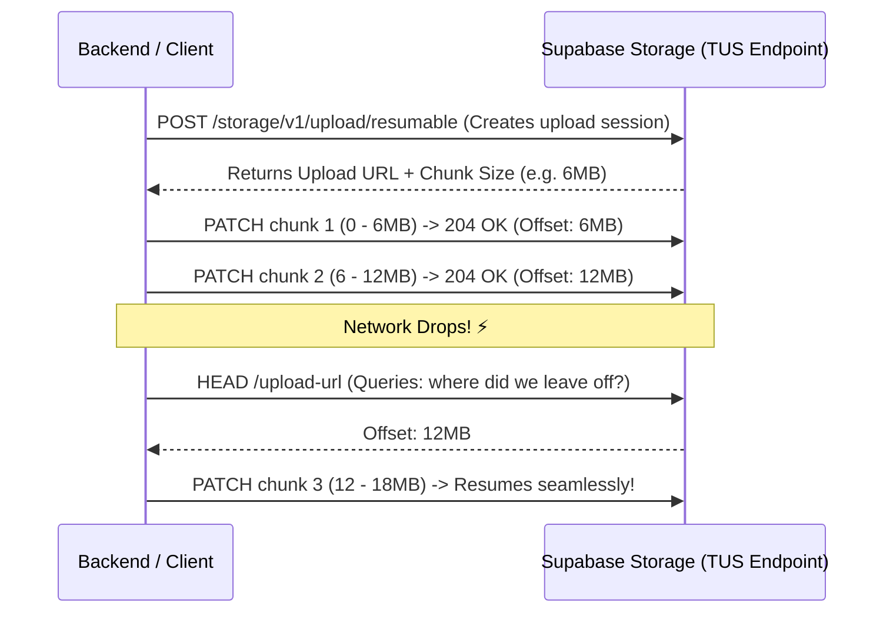
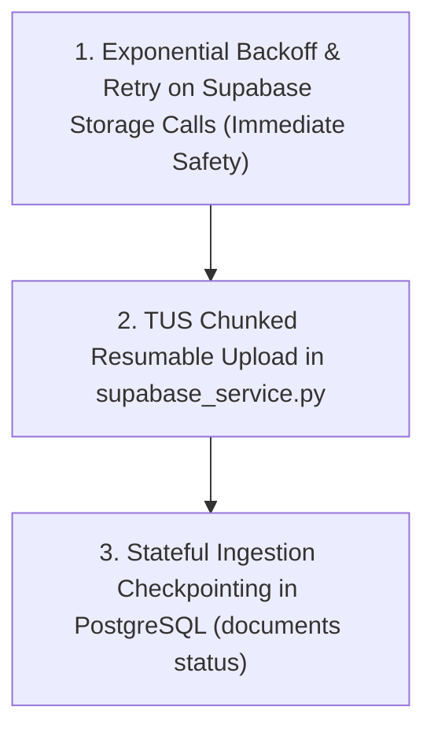

# Plan: Resumable Packeted Uploads & Network Fault Tolerance

## 1. Goal Description
When uploading and indexing large PDFs (e.g. 30MB+ / 400 pages), network drops, socket timeouts, or intermittent connectivity between the client, the backend, and Supabase can cause entire uploads to fail midway.

The goal is to implement **packeted/chunked transfers with state tracking and resumption**, so that:
1. Large files are transferred in verifiable packets/chunks (e.g. 5MB chunks).
2. If the connection drops at chunk 4 of 6, only chunk 5 and 6 need to be uploaded upon reconnection—never restarting from scratch.
3. Ingestion progress is statefully tracked in Supabase PostgreSQL so the backend and clients know exactly what arrived and what remains.

---

## 2. Technical Evaluation of Options

### Option A: Supabase Native TUS Protocol (Industry Standard for Resumable Storage)
Supabase Storage natively supports the **TUS (tus.io) Resumable Upload Protocol** (the same protocol used by Cloudflare, Vimeo, and GitHub).



- **Pros**: Zero data loss, standard RFC protocol, built right into Supabase Storage.
- **How it works**: Uses `tus-py` or standard chunked HTTP `PATCH` requests with `Upload-Offset` headers.

---

### Option B: Stateful Ingestion Tracker in PostgreSQL (`document_ingestion_jobs`)
For the processing phase (parsing, markdown, extracts, and vector embeddings):
Create a jobs table to track exactly which packets/steps have completed:

```sql
CREATE TABLE IF NOT EXISTS public.ingestion_jobs (
    id UUID PRIMARY KEY DEFAULT gen_random_uuid(),
    filename TEXT NOT NULL,
    total_bytes BIGINT NOT NULL,
    bytes_uploaded BIGINT DEFAULT 0,
    total_chunks INTEGER DEFAULT 0,
    chunks_embedded INTEGER DEFAULT 0,
    status TEXT DEFAULT 'pending', -- 'uploading', 'parsed', 'embedding', 'completed', 'failed'
    last_error TEXT,
    updated_at TIMESTAMPTZ DEFAULT NOW()
);
```

If processing or network fails at page 250 of 400:
- The system checks `ingestion_jobs`.
- It sees pages 1–250 were already processed and stored in Supabase.
- It resumes immediately from page 251.

---

### Option C: Direct-to-Supabase Mobile Upload + Webhook / Trigger
For mobile apps where cellular connections are most volatile:
1. The **mobile app uploads directly to Supabase Storage** via the Supabase client library (which has built-in TUS chunking). If the user drives through a tunnel, the mobile SDK automatically pauses and resumes.
2. Once the upload is complete, the mobile app notifies the backend: `POST /process { "file_path": "pdfs/book.pdf" }`.
3. The backend does the heavy PDF parsing, vector embedding, and extract generation on a stable data center connection.

---

## 3. Recommended Phased Implementation



### Phase 1: Robust Retry Transport with Exponential Backoff
Wrap all Supabase HTTP storage calls with a resilient retry transport (e.g. `tenacity` or `urllib3.util.retry`):
- Handles `503 Service Unavailable`, `504 Gateway Timeout`, `ConnectionResetError`, and socket dropouts.
- Automatically retries 3 to 5 times with exponential jitter (1s, 2s, 4s, 8s).

### Phase 2: TUS Resumable Chunked Uploader
In [`core/supabase_service.py`](file:///home/duke-cre/Programs/AI-powered-PDF-reader/backend/core/supabase_service.py):
- Implement `upload_file_resumable(storage_path, file_stream, chunk_size=6*1024*1024)`:
- Chunks the 30MB file into 5 × 6MB packets.
- Emits progress logs: `Packet 1/5 sent`, `Packet 2/5 sent`, etc.
- If packet 3 fails, retries packet 3 without re-sending packets 1 and 2.

### Phase 3: Stage-by-Stage Checkpointing in `documents`
Update the `documents` table to record granular ingestion checkpoints:
- `status`: `'pdf_stored'` -> `'markdown_stored'` -> `'extracts_stored'` -> `'vectors_embedded'` -> `'ready'`.
- If an operation fails midway, any retry skips already-completed assets.

---

## 4. Verification Plan

1. **Simulated Network Interruption Test**:
   - Write a unit test that mocks network disconnect on packet 2, verifies retry offset, and checks final file integrity.
2. **Chunk Checkpoint Test**:
   - Verify that resumed processing picks up at the correct chunk offset without duplicate vectors in ChromaDB.

---

## 5. Decisions For You

1. **Backend-Side Chunking vs. Client-Side Chunking**:
   - Do you want the **Backend** to chunk files when uploading to Supabase?
   - Or would you also like the **Mobile / Web Client** to upload directly to Supabase Storage with TUS chunking (so the phone never drops a 30MB upload to your server)?
2. **Preferred Chunk Size**:
   - Standard TUS chunk size is **6 MB** (meaning a 30MB file sends exactly 5 packets). Does 6 MB sound good?
