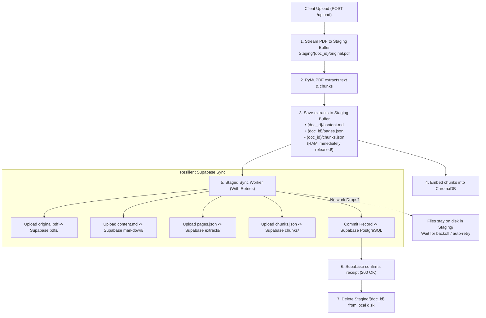

# Plan: Staged Scratch Buffer & Resilient Supabase Sync Architecture

## 1. Goal Description

When processing large documents (e.g., 30MB / 400 pages), keeping uncommitted files or retrying network uploads in-memory poses two major risks:
1. **Memory Exhaustion (OOM)**: Holding files and extracts in RAM while waiting on network I/O starves other requests (such as chat queries).
2. **Network Volatility**: If Supabase drops the connection midway, in-memory data is lost, forcing the user to start the upload and CPU-heavy text extraction all over again.

### What This Architecture Accomplishes:
- **Zero Long-Lived Memory Footprint**: Uploads and extracts immediately write to an on-disk **Staging Buffer** (`Staging/<doc_id>/`), instantly freeing RAM.
- **Network Resilience / Fault Tolerance**: If Supabase or the network drops during upload, the staged files remain safely on disk. The system retries sending from disk without re-parsing.
- **Safe Automatic Cleanup**: Files are **only deleted from local disk after Supabase confirms successful receipt** (HTTP 200/204) and the database record is committed.
- **Centralized Security**: The FastAPI backend remains the single source of truth for authorization, processing, and vector search.

---

## 2. Architecture & Data Flow



---

## 3. Detailed Component Design

### 3.1 The Staging Directory Structure
A dedicated scratch directory at `backend/Staging/` (git-ignored):
```
backend/Staging/
└── <doc_id>/
    ├── state.json           # Tracks progress: {"pdf": true, "md": false, ...}
    ├── original.pdf         # The uploaded PDF
    ├── content.md           # Extracted Markdown
    ├── pages.json           # Per-page structured JSON
    └── chunks.json          # Text chunks for vector indexing
```

### 3.2 State Tracking (`state.json`)
Each document folder has a lightweight JSON state file tracking upload checkpoints:
```json
{
  "doc_id": "9b1deb4d-3b7d-4bad-9bdd-2b0d7b3dcb6d",
  "filename": "textbook.pdf",
  "file_size": 31457280,
  "page_count": 412,
  "status": "syncing",
  "synced_assets": {
    "pdf": true,
    "markdown": true,
    "extracts": false,
    "chunks": false
  },
  "db_committed": false,
  "created_at": "2026-11-23T15:20:00Z"
}
```

### 3.3 The Sync & Retry Logic
When streaming files from the `Staging/` folder to Supabase:
1. **Check which assets are not yet marked `true`** in `state.json`.
2. Upload missing files one by one with **exponential backoff & jitter** (e.g., retry 3 times on connection failure).
3. If Supabase is completely down or drops out:
   - The state is preserved on disk in `state.json`.
   - RAM is completely free (0 bytes held in memory).
   - An asynchronous background worker (or manual retry trigger) resumes the upload later.
4. **Final Confirmation**:
   - Once all 4 assets are uploaded and `record_document(...)` succeeds:
   - Call `shutil.rmtree(staging_path)` to completely remove the temporary folder from the disk.

---

## 4. Proposed File Changes

### 1. `core/staging_manager.py` [NEW]
Handles disk staging and cleanup:
- `create_staging_area(filename: str) -> StagingContext`: Creates `Staging/<doc_id>/`.
- `save_staged_extracts(staging_ctx, md_text, pages_list, chunks_list)`: Writes extracts to disk and returns file paths.
- `update_stage_state(staging_ctx, key: str, value: bool)`: Updates checkpoints.
- `cleanup_staging_area(staging_ctx)`: Safely deletes `Staging/<doc_id>/` upon verified completion.
- `list_pending_staging_jobs() -> list[Path]`: Identifies any interrupted jobs on server restart to auto-resume.

### 2. `core/supabase_sync.py` [NEW]
Handles the resilient upload from disk to Supabase:
- Streams directly from the staged files on disk:
  ```python
  with open(staging_ctx.pdf_path, "rb") as f:
      upload_bytes(f"pdfs/{filename}", f.read(), ...)
  ```
- Implements exponential backoff retry for network resilience.
- Only triggers cleanup once all assets and PostgreSQL metadata are verified.

### 3. `core/parser.py` [MODIFY]
- Reads from `staging_ctx.pdf_path`.
- Writes `.md`, `.json`, and `_chunks.json` to the staging directory instead of holding large strings across network calls.
- Emits chunks for ChromaDB embedding.
- Closes the PyMuPDF document handle explicitly (`doc.close()`) to immediately release C heap memory.

### 4. `core/orchestrator.py` [MODIFY]
- Rewires `save` and `process` to use `StagingContext`.
- If an upload fails midway, leaves the staged folder on disk with status `interrupted` for resumption.
- Only cleans up `Staging/<doc_id>` once Supabase sync is 100% complete.

---

## 5. Benefits Over Previous Approaches

| Criteria | In-Memory Model | Earlier Local Disk Model | **Staged Scratch & Sync Pipeline (This Plan)** |
| :--- | :--- | :--- | :--- |
| **RAM Footprint** | High (held in RAM during network transfer) | Low (on disk) | **Low (cleared from RAM immediately)** |
| **Network Resilience** | Low (drop = start completely over) | None (no Supabase sync) | **High (staged on disk, resumes from checkpoint)** |
| **Server Disk Usage** | 0 MB disk | Accumulated forever (~50MB/book) | **0 MB permanent (auto-deleted upon confirmed sync)** |
| **Security & Centralization** | Centralized | Centralized | **Centralized (FastAPI controls all access & auth)** |

---

## 6. Verification Plan

1. **Normal Flow Test**:
   - Upload sample PDF.
   - Verify `Staging/<doc_id>` is created during processing.
   - Verify all assets land in Supabase Storage and DB record is created.
   - Verify `Staging/<doc_id>` is cleanly deleted after completion.
2. **Network Interruption Simulation**:
   - Mock a network error on the 3rd asset (`extracts`).
   - Verify `state.json` records `pdf: true, markdown: true, extracts: false`.
   - Verify staged folder remains on disk.
   - Trigger resume and verify it skips uploading `pdf` and `markdown` and only sends `extracts` and `chunks`.
3. **Unit Tests**:
   - Run complete test suite with 100% mocked offline tests.
