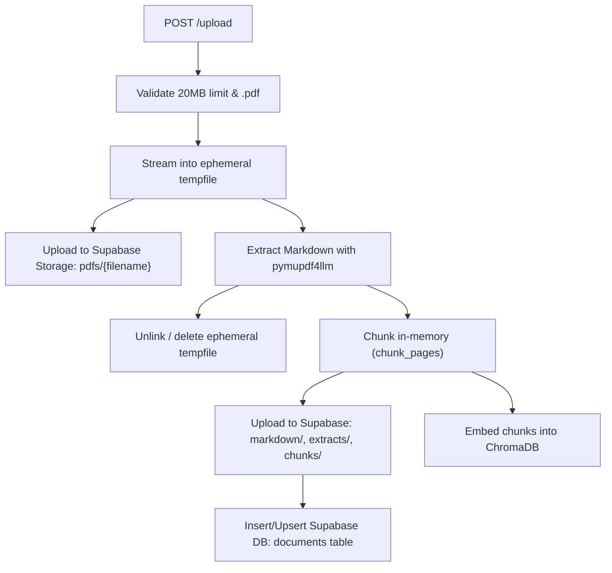

# Plan: Transitioning Supabase to Primary Pipeline & Removing Former Local Upload Process

## 1. Goal Description
Currently, Supabase is treated as an optional secondary layer with local disk directories (`Media/Uploads` and `Media/Extracts`) acting as the primary store. 

This plan will:
1. Make **Supabase the primary, mandatory engine** for document storage and catalog management.
2. **Decommission and remove the former local upload and extract storage process** (`Media/Uploads/` and `Media/Extracts/`), using ephemeral scratch spaces (`tempfile`) strictly during text extraction with immediate cleanup.
3. Stream all assets directly to **Supabase Storage** (`pdfs/`, `markdown/`, `extracts/`, `chunks/`) and track catalog metadata exclusively in **Supabase PostgreSQL** (`documents` table).
4. Update all file-serving, listing, and parsing endpoints to query Supabase directly.

---

## 2. User Review Required

> [!IMPORTANT]
> **Supabase Credentials Will Be Strictly Required**
> The backend will require valid `SUPABASE_URL` and `SUPABASE_SERVICE_ROLE_KEY` environment variables. If missing or configured with dummy values, operations will fail fast with a clear `ConfigurationError`.

> [!WARNING]
> **Deprecation of Local `Media/` Folder Storage**
> The server will no longer permanently save uploaded PDFs or extracted `.md`/`.json` files on the local filesystem. All file persistence will live in your Supabase bucket (`pdf-reader`). Any local parsing will use ephemeral OS temp files cleaned up immediately upon completion.

---

## 3. Open Questions & Alignment

1. **Local ChromaDB vs. Supabase pgvector**:
   - For this phase, we continue using ChromaDB for persistent vector similarity search, while document binaries and extracts live in Supabase. Is that aligned with your plan, or do you eventually want vector embeddings in Supabase as well?
2. **Existing Local Files**:
   - Should we delete or leave existing historical files currently in `Media/Uploads` and `Media/Extracts` on your local machine untouched, while pointing all application code exclusively to Supabase?

   ## Ans: 
    - we should stick to chroma db
    - leave exiting local file


---

## 4. Proposed Changes



### Component 1: Supabase Configuration & Core Service (`core/supabase_service.py`)
- Remove optional fallback logic (`is_supabase_enabled()` no longer gracefully bypasses when unset; instead, `require_supabase()` enforces valid configuration).
- Standardize singleton client initialization using `SUPABASE_SERVICE_ROLE_KEY`.

#### [MODIFY] `core/supabase_service.py`
- Replace optional checks with mandatory validation.
- Provide clean storage methods: `upload_file`, `download_file`, `stream_file`.
- Provide database CRUD methods: `insert_document`, `get_document`, `list_documents`, `delete_document`.

---

### Component 2: Ingestion & Upload Decommissioning (`core/orchestrator.py` & `core/parser.py`)
- Eliminate permanent writes to `BASE_DIR / "Media" / "Uploads"` and `BASE_DIR / "Media" / "Extracts"`.

#### [MODIFY] `core/parser.py`
- Change signature to accept in-memory content or a temp file path:
  `parse_pdf(file_path: Path, filename: str) -> dict`.
- Parse text via `pymupdf4llm.to_markdown(..., page_chunks=True)`.
- Generate markdown string, per-page JSON metadata, and chunk objects in-memory.
- Upload directly to Supabase Storage:
  - `markdown/{stem}.md`
  - `extracts/{stem}.json`
  - `chunks/{stem}_chunks.json`
- Index chunks in ChromaDB directly from memory (`embed(chunks_data, stem)`).
- Return in-memory metadata (`page_count`, chunk count, etc.) without writing `.md`/`.json` to local disk.

#### [MODIFY] `core/orchestrator.py`
- Update `save(file: UploadFile)`:
  - Validate PDF extension and enforce 50MB streaming ceiling using a temporary scratch file in OS temp dir (`tempfile.NamedTemporaryFile`).
  - Read bytes and upload directly to Supabase Storage: `pdfs/{filename}`.
  - Return temporary file handle and filename for immediate processing.
- Update `process(...)`:
  - Call updated `parse_pdf`.
  - Insert record into Supabase PostgreSQL `documents` table (`filename`, `file_path`, `markdown_path`, `json_extract_path`, `chunks_path`, `file_size_bytes`, `page_count`, `status`).
  - Ensure temporary scratch file is deleted in a `finally` block.

---

### Component 3: API & Serving Endpoints (`core/doc_selector.py`, `core/get_uploaded_files.py`, `app.py`)
- Decouple all endpoints from local directory checks.

#### [MODIFY] `core/get_uploaded_files.py`
- Query the `documents` table in Supabase PostgreSQL:
  `supabase.table("documents").select("filename").order("created_at", desc=True).execute()`.
- Return list of document names.
- Remove all `UPLOAD_DIR.iterdir()` filesystem scanning.

#### [MODIFY] `core/doc_selector.py`
- Remove `UPLOAD_DIR` local disk lookup.
- Fetch the PDF directly from Supabase Storage `pdfs/{filename}`.
- Stream binary bytes directly to the client as `StreamingResponse` or `Response(media_type="application/pdf")`.
- Keep path traversal guards (`..`, `/`, `\`).

#### [MODIFY] `app.py`
- Remove `UPLOAD_DIR = BASE_DIR / "Media" / "Uploads"` and folder creation.
- In `/markdown/{filename}`: Fetch `extracts/{filename}.json` (or `markdown/{filename}.md`) directly from Supabase Storage.
- Return 404 if not found in Supabase Storage.

---

### Component 4: Test Suite Modernization (`tests/`)
- Update tests to reflect Supabase as the primary process.

#### [MODIFY] `tests/test_api.py`
- Mock `supabase_service` storage and DB calls in `TestAppEndpoints` (e.g. for `/files/{filename}`, `/list_files`, `/markdown/{filename}`).
- Remove local filesystem assertions (`UPLOAD_DIR / f"{name}.pdf"`).

#### [MODIFY] `tests/test_doc_selector.py`
- Test `set_document` against mocked Supabase Storage responses instead of local file creation.

#### [MODIFY] `tests/test_supabase.py`
- Ensure tests verify required credentials, upload/download methods, and DB operations.

---

## 5. Verification Plan

### Automated Tests
1. Run full test suite:
   ```bash
   uv run python -m unittest discover tests
   ```
2. Run verbose API endpoint tests:
   ```bash
   uv run python -m unittest tests/test_api.py -v
   ```
3. Run doc selector tests:
   ```bash
   uv run python -m unittest tests/test_doc_selector.py -v
   ```

### Verification Checks
- [ ] No new files or directories created in `Media/Uploads` or `Media/Extracts` during upload and parsing.
- [ ] Uploaded PDFs reside in Supabase Storage (`pdfs/`).
- [ ] Uploaded extracts reside in Supabase Storage (`markdown/`, `extracts/`, `chunks/`).
- [ ] Documents table in Supabase PostgreSQL is populated on upload.
- [ ] `/list_files` reflects documents from Supabase PostgreSQL.
- [ ] `/files/{filename}` streams PDF from Supabase Storage.
- [ ] `/markdown/{filename}` returns page JSON from Supabase Storage.
