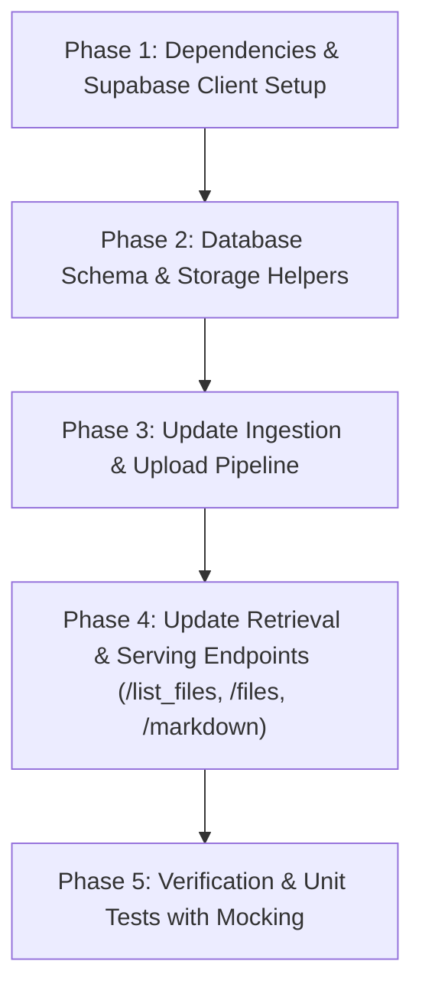

# Supabase Integration Plan: Database & Storage for Bud Backend

## 1. Overview & Objectives

Migrate document asset storage and catalog tracking from local disk (`Media/Uploads` and `Media/Extracts`) to **Supabase**:
1. **Supabase Storage**: A dedicated bucket storing:
   - Raw PDF files (`/pdfs/{filename}`)
   - Markdown representations (`/markdown/{filename}.md`)
   - Per-page structured JSON extracts (`/extracts/{filename}.json`)
   - Chunked JSON data (`/chunks/{filename}_chunks.json`)
2. **Supabase Database (PostgreSQL)**:
   - Replace filesystem scanning (`os.iterdir()`) with a `documents` table for fast querying, sorting, pagination, and metadata tracking (page count, size, timestamps, status).
3. **Local Scratch / Cache**:
   - Keep temporary parsing in a temporary directory or local cache during processing, then flush to Supabase.
   - Continue utilizing **ChromaDB** for vector embeddings (or prepare hooks for future pgvector migration if ever desired).

---

## 2. Architecture & Data Model

### 2.1 Database Schema (`documents` table)

```sql
CREATE TABLE IF NOT EXISTS documents (
    id UUID PRIMARY KEY DEFAULT gen_random_uuid(),
    filename TEXT NOT NULL UNIQUE,
    title TEXT,
    file_path TEXT NOT NULL,         -- Path in Supabase bucket, e.g. "pdfs/sample.pdf"
    markdown_path TEXT,              -- Path in bucket, e.g. "markdown/sample.md"
    json_extract_path TEXT,          -- Path in bucket, e.g. "extracts/sample.json"
    chunks_path TEXT,                -- Path in bucket, e.g. "chunks/sample_chunks.json"
    file_size_bytes BIGINT,
    page_count INTEGER,
    status TEXT DEFAULT 'processed', -- e.g. 'processing', 'processed', 'error'
    created_at TIMESTAMPTZ DEFAULT NOW(),
    updated_at TIMESTAMPTZ DEFAULT NOW()
);

-- Index for fast lookup by filename
CREATE INDEX IF NOT EXISTS idx_documents_filename ON documents(filename);
```

### 2.2 Storage Bucket Layout

Bucket name: `pdf-reader` (configurable via `SUPABASE_STORAGE_BUCKET`):
```
pdf-reader/
├── pdfs/
│   └── <filename>.pdf
├── markdown/
│   └── <filename>.md
├── extracts/
│   └── <filename>.json
└── chunks/
    └── <filename>_chunks.json
```

---

## 3. Component Impact & Changes

### 3.1 Dependencies & Configuration
- **Package**: Add `supabase>=2.10.0` to `pyproject.toml`.
- **Environment variables (`.env`)**:
  - `SUPABASE_URL`: Supabase project URL (`https://<project-ref>.supabase.co`).
  - `SUPABASE_KEY` / `SUPABASE_SERVICE_ROLE_KEY`: Service role key (for server-side bypass of RLS during backend storage operations).
  - `SUPABASE_STORAGE_BUCKET`: Default `pdf-reader`.

### 3.2 New Module: `core/supabase_service.py`
Create a centralized client and helper class:
- `get_supabase_client()`: Singleton client initializer.
- `upload_file(bucket_path: str, data: bytes | BinaryIO, content_type: str) -> str`
- `download_file(bucket_path: str) -> bytes`
- `get_signed_url(bucket_path: str, expires_in: int = 3600) -> str`
- `delete_file(bucket_paths: list[str])`
- `record_document(metadata: dict) -> dict`
- `get_document_by_name(filename: str) -> dict | None`
- `list_documents() -> list[dict]`
- `delete_document(filename: str) -> bool`

### 3.3 Changes to Existing Modules

#### A. `core/parser.py`
- Accepts PDF bytes or a temporary file path.
- Performs text extraction via `pymupdf4llm` and chunking via `chunker.py`.
- Instead of writing directly to `Media/Extracts`, returns the in-memory or temp outputs:
  - Markdown text
  - Pages JSON list
  - Chunks data list
- Passes them to the storage service to upload to the Supabase bucket.

#### B. `core/orchestrator.py`
- **Upload flow**:
  1. Stream file upload into a temporary file or buffer to enforce the 20MB limit.
  2. Upload original PDF to Supabase bucket: `pdfs/{filename}`.
  3. Parse pages, generate markdown, extract JSON, and chunk.
  4. Upload `.md`, `.json`, and `_chunks.json` to the Supabase bucket.
  5. Record/Upsert document entry in the `documents` table.
  6. Embed chunks and index into ChromaDB.
  7. Clean up temporary local files.

#### C. `core/get_uploaded_files.py` (`/list_files`)
- Replaces scanning `UPLOAD_DIR.iterdir()` with a database query:
  `supabase.table("documents").select("filename").execute()`.
- Returns `{"files": [...]}`.

#### D. `core/doc_selector.py` (`/files/{filename}`)
- Two serving options:
  - **Option 1 (Proxy/Stream)**: Download file stream/bytes from Supabase Storage and return `StreamingResponse(content, media_type="application/pdf")`.
  - **Option 2 (Signed URL Redirect)**: Generate a temporary signed download URL from Supabase Storage and redirect (`RedirectResponse(url)`).
  *(Option 1 preserves existing client compatibility where clients expect binary PDF stream directly).*

#### E. `app.py` (`/markdown/{filename}`)
- Retrieves the extracted JSON / Markdown content directly from Supabase Storage (or cache), falling back gracefully.

---

## 4. Phased Implementation Roadmap



- **Phase 1: Setup & Connection**
  - Add `supabase` dependency.
  - Define `.env.example` configurations.
  - Create `core/supabase_service.py` with singleton initialization.
- **Phase 2: Storage & DB Access Layer**
  - Implement storage upload/download routines and database CRUD methods.
  - Provide a SQL migration / script for creating the `documents` table and storage bucket policy.
- **Phase 3: Integration into Ingestion (`parser.py` & `orchestrator.py`)**
  - Update `parse_pdf` to produce extracts for Supabase upload.
  - Update `orchestrator.save` and `process` to push files to Supabase Storage and insert metadata into Postgres.
- **Phase 4: Endpoint Updates**
  - Update `/list_files` to read from the database.
  - Update `/files/{filename}` and `/markdown/{filename}` to fetch from Supabase Storage.
- **Phase 5: Testing & Reliability**
  - Add unit tests with mock Supabase responses (ensuring test suite runs without requiring live cloud credentials).
  - Test end-to-end upload and retrieval.

---

## 5. Key Questions & Design Decisions for You

1. **Direct Streaming vs. Signed URL**:
   When client calls `GET /files/{filename}`, should the FastAPI backend:
   - Stream the PDF bytes directly through FastAPI (keeps API contract identical)?
   - Or redirect (302) to a Supabase Storage signed URL (faster, offloads bandwidth from your server)?
2. **Local Fallback / Development Mode**:
   Should we maintain a local disk fallback if `SUPABASE_URL` is empty, or should Supabase be the sole storage engine?
